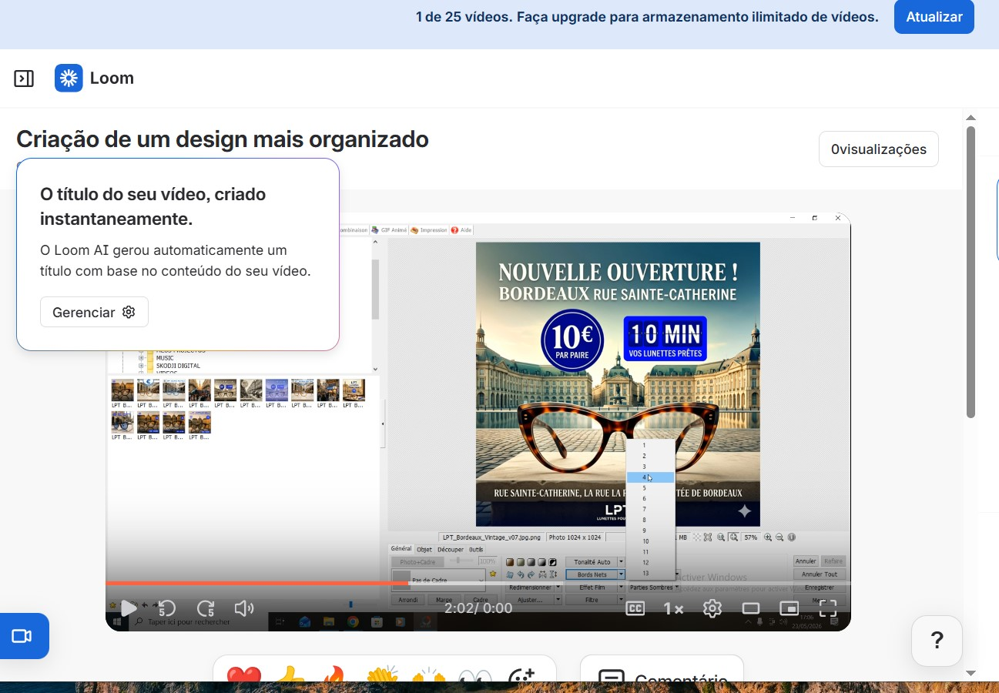

<p align="center">
  
</p>

<h1 align="center">⚡ Florivindo Semedo Monteiro</h1>
<p align="center"><b>Senior AI Automation Engineer | Full-Stack Product Builder | Executive Web & UI/UX Designer</b></p>

<p align="center">
  <a href="https://www.linkedin.com/in/florivindo-monteiro-15181b73/"></a>
  <a href="https://www.youtube.com/@cvboyrecords01"></a>
  <a href="https://www.cvboyrecords.com"></a>
  <a href="https://digitalizagencia.cvboyrecords.com"></a>
</p>

<p align="center">
  
  
  
  
</p>

---

## 🏛️ Executive Summary & Engineering Profile

Senior Systems Architect, AI Engineer, and Executive Web Designer specializing in enterprise process automation, self-hosted autonomous agent ecosystems, and high-converting responsive interfaces. Expert in bridging complex operational business workflows with modern front-end architectures and hardened cloud infrastructure.

* **Autonomous AI Agents & Workflows:** Custom n8n workflow engineering, Typebot logic, Evolution API WhatsApp routing, Open-source LLM integration (Qwen/Wan), autonomous lead scoring, automated Gmail ingestion.
* **Executive Web Design & UI/UX:** Luxury landing pages, responsive mobile-first interfaces, modern dark-mode glassmorphism aesthetic, Tailwind CSS design systems, dynamic multi-language (i18n) engine, conversion-rate optimization (CRO), automated client timezone detection.
* **Enterprise Infrastructure & Security:** Self-hosted Linux VPS server orchestration (Docker, Traefik, Caddy reverse proxies), zero-trust webhook ingestion, SSL automation, GDPR & privacy-first data protocols.
* **Creative Direction & Media Production:** AI visual generation, 8K cinematic artwork engineering, audio/video post-production workflows (DaVinci Resolve, Blender, Cubase, PhotoScape).

---

## 🌐 Live Production Ecosystems (Live Deployments)

| Platform | Domain | Focus Area | Tech Stack |
| :--- | :--- | :--- | :--- |
| **CV Boy Records Agency** | [cvboyrecords.com](https://www.cvboyrecords.com) | Official Flagship Agency & Digital Assets | HTML5, Tailwind CSS, AI Media Pipelines |
| **Digitalizagência** | [digitalizagencia.cvboyrecords.com](https://digitalizagencia.cvboyrecords.com) | Singapore-Standard Autonomous Lead Capture | n8n Webhooks, Executive UI, Timezone Engine |
| **Agenda Online SaaS** | [agenda-online.cvboyrecords.com](https://agenda-online.cvboyrecords.com) | Interactive Booking & Financial SaaS | Multi-language UI/UX, Google Sheets CRM |

---

## 📂 Featured Enterprise Projects & Repositories

### 1. 🎨 Executive Web Design & Front-End Engineering
* **`saas-agendamento-frontend`** — High-end responsive UI/UX design with dark glassmorphism aesthetic, automated timezone detection, and smooth cross-browser performance.
* **`auditoria-publica-cv`** — Public transparency portal featuring clean component layout, accessible typography, and fast Vercel edge deployment.
* **`dveigaclamor-store`** — Luxury e-commerce frontend architecture built with Vite, Tailwind CSS, and optimized conversion pathways.

### 2. 🤖 Autonomous Public & Enterprise Systems
* **`praia-municipio-zerotouch-kiosk`** — Interactive text-to-speech & biometric simulator kiosk system built with TypeScript for local government administration.
* **`global-port-ai-assistant-os`** — High-availability AI assistant operating layer for port logistics and maritime operations handling automated queries.
* **`tribunal-digital-ai`** — Legal-tech automation engine for document parsing, case classification, and automated intake workflows.

### 3. ⚡ Enterprise Workforces & Medical Systems
* **`med-triage-manchester-ai`** — Medical triage assistant leveraging AI decision trees for client evaluation and priority queue routing.
* **`dg-workforce-dashboard`** — Operational management dashboard for real-time tracking of automated digital tasks.

---

## 🎨 Creative Direction & Multimedia Case Study

### 📌 Project LPT (Lunettes Pour Tous) — Bordeaux Workflow
Ce projet présente la méthodologie de travail pour le magasin **Lunettes Pour Tous** à Bordeaux. Il illustre la capacité à combiner l'Intelligence Artificielle avec une exécution graphique rigoureuse et le respect strict de la charte graphique.

* **Workflow de Production:**
  1. **Prompt Engineering:** Optimisation des instructions IA pour coller à l'ADN LPT.
  2. **Post-Production:** Finalisation sur PhotoScape (gestion des contrastes, typographie, haute résolution).
  3. **Organisation & Governance:** Système de versioning strict pour éviter tout overwrite accidentel.
* **🎥 Démonstration Technique:** [Regarder la Démo Vidéo sur Loom](https://www.loom.com/share/089b9e729714448d9414550ba8eb81b0)

---

## 🛠️ Technology Stack & Operating Tools

```text
Web & UI/UX Design      : Tailwind CSS, HTML5, Modern CSS3/Grid/Flexbox, Responsive UI/UX, CRO
Frontend Frameworks     : TypeScript, React, JavaScript (ES6+), Vite, Vercel, Netlify
Backend & Orchestration  : n8n, Node.js, Express, Python, REST Webhooks API, Google Sheets API
DevOps & Cloud Security  : Docker, Traefik, Caddy, Hostinger VPS KVM, Linux Security Hardening
Automations & Messaging : Evolution API (WhatsApp), Gmail API, Typebot Logic Engine
Media & Design Tools    : Adobe Photoshop, PhotoScape, DaVinci Resolve, Blender, Cubase, Sonar

---

## 🎥 Live Video Demonstrations & Workflows (Loom Portfolio)

Quer ver a engenharia em ação? Explore a minha biblioteca pública de demonstrações técnicas, arquitetura de sistemas e fluxos de automação ao vivo:

👉 **[Aceder ao Portefólio Completo de Vídeos no Loom](https://www.loom.com/looms/videos)**

*Demonstrações práticas de prompt engineering, integração de APIs n8n, interfaces de alta conversão em Tailwind CSS e arquitetura de agentes autónomos.*
